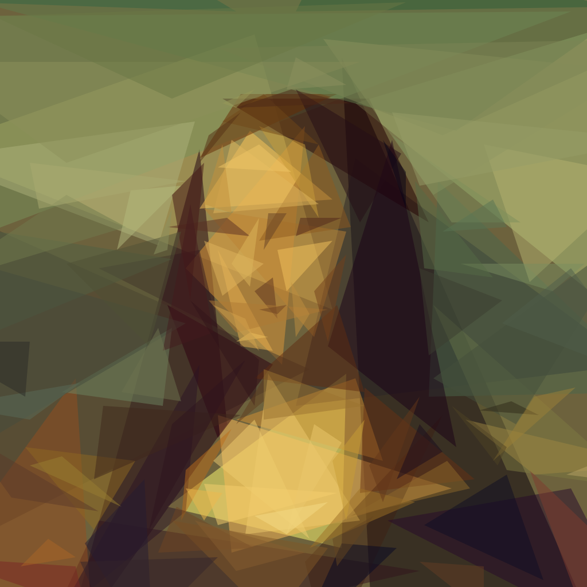
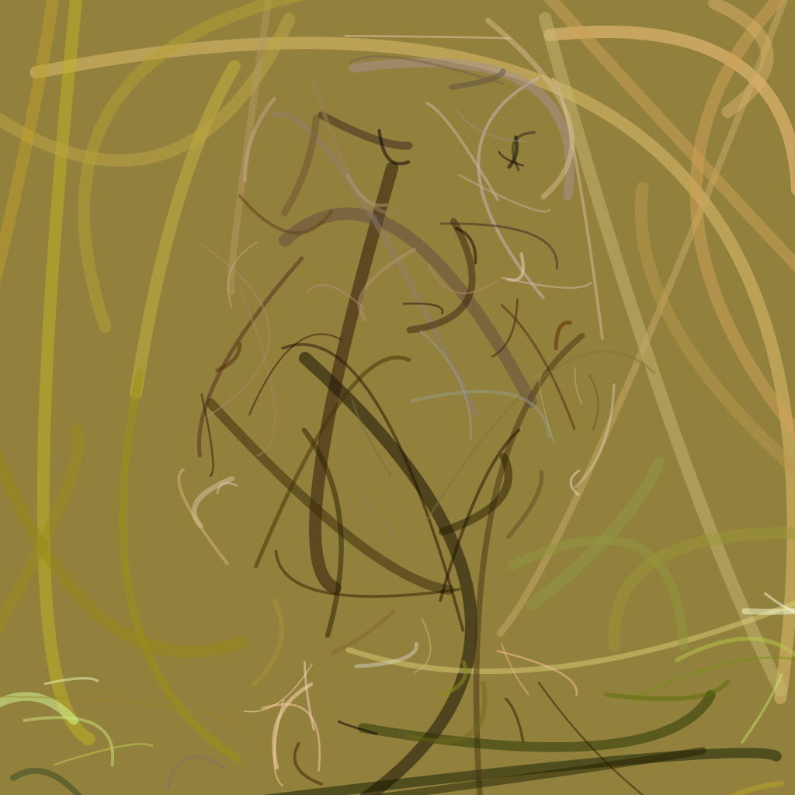
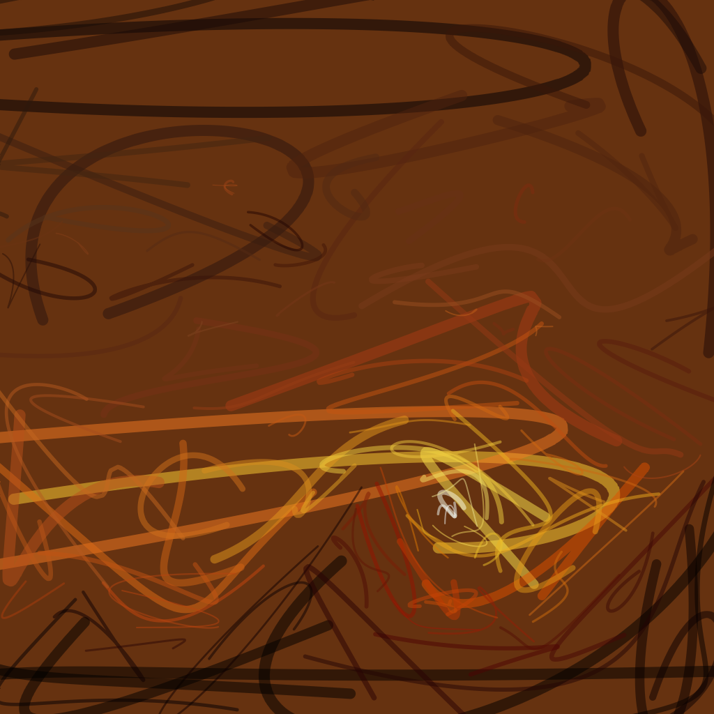

# ART — Autonomous Geometric Vector Art Engine

[](https://github.com/Raghava00001/ART/actions)
[](LICENSE.md)
[](SECURITY.md)
[](TECH_STACK.md)
[](go.mod)
[](Dockerfile)

**ART** is a high-performance vector synthesis engine that transforms raster images into beautiful geometric artwork and calligraphic strokes using hill-climbing stochastic optimization.

It pairs a multi-core Go simulation engine with an interactive, glassmorphic dark-mode web atelier that streams vector artwork in real-time.

---

## Visual Gallery (Sample Outputs)

Here are examples of artwork synthesized directly by the ART engine from sample reference photos:

| Reference Photo | Synthesized Artwork | Mode & Details |
|:---:|:---:|:---|
|  |  | **Mode 1: Geometric Triangles**<br>120 primitives with sharp planar facets capturing lighting and facial contours. |
|  |  | **Mode 6: Variable Béziers**<br>120 calligraphic brush strokes with dynamic 0.5–16px width variation. |
|  |  | **Mode 9: Cubic Bézier Splines**<br>120 4-point cubic curves capturing flowing silhouettes and natural horizons. |

---

## What We Built: Key Innovations & Enhancements

Compared to traditional primitive art generators, ART v2.0 introduces the following breakthroughs:

1. **Residual-Weighted Importance Sampling (CDF Error Maps)**:
   - *Problem*: Traditional generators randomly pick positions uniformly across an entire image, wasting 70%+ of compute cycles testing shapes on flat backgrounds.
   - *Our Solution*: We compute pixel-wise squared error $\Delta = |T - C|^2$ and build a 2D cumulative distribution function (CDF). Shapes spawn preferentially in high-error regions (facial contours, fine edges, and delicate textures).

2. **Calligraphic Bézier & Cubic Spline Engine**:
   - **Mode 6 (Variable Béziers)**: Quadratic curves with dynamic stroke widths (0.5–16px) for painterly brushwork.
   - **Mode 9 (Cubic Béziers)**: 4-control-point cubic curves ($P_0, P_1, P_2, P_3$) that naturally accommodate inflection points (S-curves) essential for hair, drapery, and flowing silhouettes.

3. **Coarse-to-Fine Multi-Resolution Annealing Pyramid**:
   - Accelerates macro composition at 64px before progressively shifting to 128px and 384px. Base color planes are established rapidly before compute is spent on micro-details.

4. **Zero-Dependency Single-Binary Architecture (`//go:embed`)**:
   - The entire web GUI, CSS stylesheets, client scripts, and sample portraits are embedded directly into the Go executable via Go's `embed.FS`. The resulting binary can be moved to any folder or machine and works instantly with zero external dependencies.

5. **Defense-in-Depth Upload Security**:
   - Decompression bomb mitigation via `image.DecodeConfig` (stops 50,000×50,000 px pixel bomb DoS attacks).
   - Magic-byte MIME sniffing (`http.DetectContentType`) rejecting malicious scripts and executable binaries.
   - Strict 20MB request body caps (`http.MaxBytesReader`) and zero permanent disk residue (`r.MultipartForm.RemoveAll()`).
   - Security headers: `X-Content-Type-Options: nosniff`, `X-Frame-Options: SAMEORIGIN`, and strict `Content-Security-Policy`. (See [SECURITY.md](SECURITY.md)).

6. **Interactive Glassmorphic Web Atelier (SSE Real-Time Streaming)**:
   - Live 60fps Server-Sent Events (SSE) streaming updates vector paths into the browser DOM in real time.
   - Interactive A/B split wipe divider, focal priority brush, live color palette extraction, and instant SVG/PNG/4K master exports.

7. **100% Passing Multi-OS Test Suite & GitHub CI**:
   - Unit tests covering scanline rasterizers, model convergence, multi-resolution retargeting, web endpoints, and upload security.
   - Automated GitHub Actions CI workflow running across **Ubuntu, macOS, and Windows**.

---

## Architecture Overview

```text
  ┌─────────────────────────────────────────────────────────┐
  │                    Input Reference                      │
  └───────────────────────────┬─────────────────────────────┘
                              │
               ┌──────────────▼──────────────┐
               │ Multi-Resolution Pyramid    │
               │ (64px ➔ 128px ➔ 256/384px)  │
               └──────────────┬──────────────┘
                              │
       ┌──────────────────────▼──────────────────────┐
       │ Residual-Weighted Importance Map (CDF)       │
       │ + Edge Saliency Guidance                    │
       └──────────────────────┬──────────────────────┘
                              │
               ┌──────────────▼──────────────┐
               │ Concurrent Workers (Hill-   │
               │ Climbing Stochastic Search) │
               └──────────────┬──────────────┘
                              │
       ┌──────────────────────▼──────────────────────┐
       │ Primitives (Triangles, Beziers, Cubics...)  │
       └──────────────────────┬──────────────────────┘
                              │
       ┌──────────────────────▼──────────────────────┐
       │ Outputs: SVG Vector / PNG Raster / GIF /    │
       │ Real-Time SSE Web Studio Stream             │
       └─────────────────────────────────────────────┘
```

For an in-depth breakdown of technology decisions, see [TECH_STACK.md](TECH_STACK.md).

---

## Live Cloud Deployment & Docker

You can run ART as a container or deploy it live to the cloud with zero setup:

### Deploy to Render (Free)
1. Fork or push this repository to your GitHub account: `https://github.com/Raghava00001/ART`.
2. Go to [Render.com](https://render.com) and click **New > Web Service**.
3. Select your repository `Raghava00001/ART`.
4. Render will automatically detect [`Dockerfile`](Dockerfile) and [`render.yaml`](render.yaml) and deploy your web studio live!

### Run Locally with Docker

```bash
# Build Docker image
docker build -t art-studio .

# Run container on port 8080
docker run -p 8080:8080 art-studio
```

Then visit `http://localhost:8080` in your web browser.

---

## Local Installation & Build

Build the single self-contained native executable using standard Go:

```bash
go build -v -o art.exe .
```

*Note: On Linux and macOS, the binary is compiled with `go build -v -o art .`.*

### Run Tests

Run the complete multi-package test suite:

```bash
go test -v ./...
```

---

## Usage

### 1. Interactive Web Studio

Launch the built-in browser studio:

```bash
art -gui -port 8080
```

Open `http://localhost:8080` in any web browser:
- **Drag & Drop** any photo or click the sample portrait to load instantly.
- **Select Primitives**: Choose from 10 geometric and calligraphic modes.
- **Priority Brush**: Paint over focal areas (eyes, mouth, signature lines) to concentrate detail.
- **A/B Split Wipe**: Slide the interactive divider to inspect raster vs. vector accuracy.
- **Export**: Download crisp scalable SVG vectors, transparent PNGs, or upscaled 4K master prints.

#### Web Studio Keyboard Shortcuts

| Shortcut | Action |
|:---|:---|
| <kbd>Enter</kbd> | Start / Stop synthesis |
| <kbd>Shift</kbd> + <kbd>Enter</kbd> | Continue / Refine current artwork |
| <kbd>Space</kbd> | Toggle Split Wipe / Vector Only view |
| <kbd>B</kbd> | Toggle Focal Priority Brush |
| <kbd>W</kbd> | Toggle Wireframe outline mode |
| <kbd>H</kbd> | Toggle Heatmap error visualization |
| <kbd>C</kbd> | Copy SVG markup to clipboard |
| <kbd>R</kbd> | Reload default reference artwork |
| <kbd>+</kbd> / <kbd>-</kbd> / <kbd>0</kbd> | Zoom In / Out / Fit to Canvas |
| <kbd>1</kbd>–<kbd>9</kbd>, <kbd>0</kbd> | Quick-switch primitive modes |
| <kbd>?</kbd> | Open Shortcuts modal dialog |

---

### 2. Command Line Interface (CLI)

```bash
art -i input.jpg -o output.png -n 150 -m 1 -r 256 -pyramid
```

To generate both a vector SVG and a high-resolution PNG simultaneously:

```bash
art -i input.jpg -o output.svg -o output.png -n 200 -m 9 -s 2048 -pyramid
```

#### CLI Options Reference

| Flag | Default | Description |
|:---|:---|:---|
| `-i` | *(required)* | Path to input image |
| `-o` | *(required)* | Path to output image (`.png`, `.jpg`, `.svg`, `.gif`, can be repeated) |
| `-n` | *(required)* | Total number of primitives to generate |
| `-m` | `1` | Primitive mode (see table below) |
| `-pyramid` | `false` | Enable coarse-to-fine multi-resolution pyramid |
| `-gui` | `false` | Launch interactive web GUI studio |
| `-port` | `8080` | Web GUI server port |
| `-r` | `256` | Simulation resolution (higher values capture finer detail) |
| `-s` | `1024` | Output image render size |
| `-a` | `128` | Alpha opacity (0–255; `0` enables automatic per-shape alpha) |
| `-rep` | `0` | Extra shape refinement steps per iteration |
| `-nth` | `1` | Save every Nth frame when `%d` is in the output path |
| `-bg` | `""` | Background color hex (defaults to average image color) |
| `-j` | `0` | Number of parallel worker threads (default uses all CPU cores) |
| `-v` | `false` | Verbose progress logging |
| `-vv` | `false` | Extra verbose debugging output |

---

## Primitive Modes

| Mode | Shape Type | Description |
|:---:|:---|:---|
| **0** | Combo All | Dynamically mixes all available shapes |
| **1** | Triangles | Sharp geometric facets; ideal for low-poly portraits & architecture |
| **2** | Rectangles | Axis-aligned bounding boxes |
| **3** | Ellipses | Smooth elliptical splats |
| **4** | Circles | Circular pointillism / bokeh style |
| **5** | Rotated Rectangles | Oriented rectangular strokes |
| **6** | Variable Béziers | Quadratic curves with mutable 0.5–16px width for brushwork |
| **7** | Rotated Ellipses | Tilted ellipses capturing organic curvature |
| **8** | Polygons | Convex 4-sided polygonal shards |
| **9** | Cubic Béziers | 4-point cubic spline curves with calligraphic width for hair and contours |

---

## Output Formats

- **Vector SVG (`.svg`)**: Clean, scalable, lossless vector artwork with grouped scale layers.
- **Raster Image (`.png` / `.jpg`)**: Crisp high-resolution raster output up to 7680px (8K).
- **Frame Sequence (`frame_%04d.png`)**: Save progressive evolution frame by frame.
- **Animated GIF (`.gif`)**: Generate animated timelapses illustrating generation from scratch.

---

## Contributing

Contributions, bug reports, and suggestions are welcome!
1. Fork the repository.
2. Create your feature branch (`git checkout -b feature/my-feature`).
3. Ensure all tests pass: `go test -v ./...`.
4. Commit your changes (`git commit -am 'Add new feature'`).
5. Push to the branch (`git push origin feature/my-feature`).
6. Open a Pull Request.

---

## License & Attribution

This project is licensed under the [MIT License](LICENSE.md).  
Core concept and scanline rasterizer inspired by [Michael Fogleman](https://github.com/fogleman/primitive).
